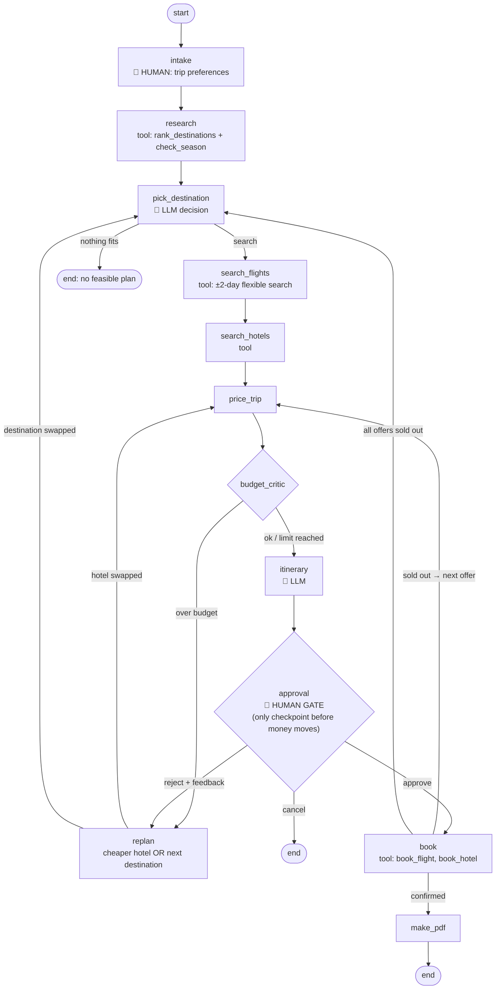

# AI Travel Planner Agent (LangGraph + LangChain)

An agentic travel planner. You give it a **budget, month, departure city, trip length and interests**, and it:

1. **Researches** every destination in India or abroad and ranks them on season (weather), estimated cost, travel time and your interests.
2. **Picks** a destination. An LLM chooses from the top-3 shortlist and explains why.
3. **Searches flights over ±2 days** and shifts your dates only if that makes flights noticeably cheaper.
4. **Searches hotels** and picks the cheapest well-rated option.
5. **Checks the budget.** A budget critic rejects plans that cost too much and forces a **re-plan** (cheaper hotel, or a different destination).
6. **Builds a day-by-day itinerary** (LLM).
7. **Stops and asks you for approval.** This is the only step that waits for you, and nothing is booked before it.
8. **Books** the flight and hotel. If the flight is sold out at booking time, it **recovers** by taking the next offer and re-checking the budget.
9. **Writes a PDF**: why this place, the best time to visit, the cost breakdown, booking references, the day-by-day plan and the agent's reasoning trace.

It ships with a **React web UI** ("Wayfarer"): a trip form, the agent's reasoning streamed live, an approval card (cost bar against the budget, flight, hotel, itinerary, approve / reject-with-feedback / cancel), a booking confirmation with a PDF download, and a table of every destination the agent considered. There is also a terminal CLI.

**Cost: ₹0.** Every external service has a free tier, and every tool also has an offline mock mode. The project runs end-to-end with **no API keys at all**.

---

## Architecture



(`docs/graph.mmd` is the diagram generated by LangGraph itself, from `graph.get_graph().draw_mermaid()`.)

### Human-in-the-loop design

* **Intake** uses LangGraph `interrupt()` to ask the user for their preferences.
* **Switching destination:** on the approval screen you can pick any other row from the "Destinations the agent considered" table. The agent re-plans flights, hotel and itinerary for it. A destination you chose yourself is never swapped by the budget critic; if it is over budget, the overrun is shown to you at the approval gate.
* **Approval** is the single gate before any irreversible action (booking or payment). The agent works autonomously up to that point. Interview line: *"fully autonomous, with a single approval gate before any irreversible action."*
* If you **reject** the plan with free-text feedback ("too expensive", "somewhere else", "nicer hotel"), the feedback is classified (by the LLM, with a keyword fallback) into a re-plan action.
* If booking forces a change (sold-out flight) and the new plan is **not more expensive** than what you approved, the agent carries on without asking again. If it costs more, it asks for approval again.
* A checkpointer (`InMemorySaver`) persists the state, so the graph can pause and resume across interrupts.

### Where the agent actually reasons

| Behaviour | Where |
|---|---|
| Trade-off between cost, season, travel time and interests | `tools/destinations.py` (weighted score) + `pick_destination` (LLM picks from the top 3 and explains) |
| Flexible-date search: shift ±2 days only if it saves ≥8% | `nodes.search_flights` |
| Budget critic, then re-plan (cheaper hotel if that closes the gap, otherwise switch destination) | `nodes.budget_critic`, `nodes.replan` |
| Recovery from booking failure (sold out → next offer → re-check budget → re-approve only if pricier) | `nodes.book`, `nodes.approval` |
| Human feedback → structured action | `nodes.classify_feedback` |
| Day-by-day itinerary | `nodes.itinerary` (LLM output is validated, with a template fallback) |

### Why a graph and not a free-form ReAct agent?

Small free models (7B on the HuggingFace free tier) are unreliable at long tool-calling loops. Here the **control flow** (budget limits, approval gate, retries) is fixed in the LangGraph graph, so it is guaranteed. The **judgement calls** (which destination, the itinerary, what the feedback means) go to the LLM. Every LLM output is validated by `llm.ask_json`, and if the output is invalid the agent falls back to rule-based logic. As a result the agent **never books anything without approval and never crashes because of a bad LLM reply**. That is a good design point to talk about in interviews.

---

## Tech stack (all free)

| Part | Used | Free? |
|---|---|---|
| Orchestration | **LangGraph** (`StateGraph`, conditional edges, `interrupt`, `Command(resume=…)`, checkpointer) | ✅ open source |
| Tools / LLM interface | **LangChain** (`@tool`, `ChatHuggingFace`, `HuggingFaceEndpoint`, `HuggingFacePipeline`) | ✅ open source |
| LLM | HuggingFace `Qwen/Qwen2.5-7B-Instruct` via serverless inference, **or** a local `Qwen2.5-0.5B-Instruct`, **or** none (rules) | ✅ free token / local |
| Flights | **Duffel test mode** (real search + real sandbox orders, no money), or **SerpAPI Google Flights**, or the mock | ✅ test mode / 100 free searches/month |
| Hotels | **SerpAPI Google Hotels** for real prices, or the mock. Booking is simulated (real hotel booking APIs need partner access) | ✅ |
| Weather / season | **Open-Meteo** historical archive (no key) + built-in "best months" knowledge | ✅ |
| PDF | `fpdf2` | ✅ |
| Backend API | **FastAPI** + Uvicorn; streams agent steps as NDJSON; the approval gate is `POST /api/trips/{id}/decision` | ✅ |
| Frontend | **React 18 + Vite** (plain CSS, light/dark, mobile friendly) | ✅ |

Provider order: **Duffel → SerpAPI → mock**. If any provider fails (network, quota, unsupported route), the tool falls back to the mock instead of crashing the agent. SerpAPI responses are cached on disk (`.cache/`) to protect the free quota.

---

## How to run

### 1. One-time setup (WSL / Linux / macOS)

```bash
cd ~/projects/ai-travel-planner
python3 -m venv .venv
source .venv/bin/activate
pip install -r requirements.txt
cp .env.example .env          # then fill in the keys you have (all optional)
```

### 2. Start the app (UI + backend, one command)

```bash
source .venv/bin/activate
uvicorn travel_agent.api:app --port 8000
```

Open **http://localhost:8000**. The React app is already built into `frontend/dist`, and FastAPI serves it, so **Node.js is not needed just to run the app**.

The pills in the top bar show what is active, e.g. `LLM: Qwen/Qwen2.5-7B-Instruct · Flights: duffel · Hotels: serpapi`. `rule-based` / `mock` means that key isn't set.

### 3. Other entry points

```bash
python main.py --demo                     # terminal version (asks for approval in the terminal)
python main.py                            # terminal version, asks all trip questions
pytest -q                                 # 14 tests (graph + API), always offline
python -m eval.run_eval                   # 20-request benchmark -> eval/results.json
python -m eval.run_eval --reject-first    # benchmark where the human rejects every first plan
python -m eval.run_eval --use-llm         # benchmark with the HuggingFace LLM in the loop
```

### 4. Editing the UI (only if you change the React code)

Install **Node.js inside WSL**. Don't use the Windows one: `which npm` must *not* print `/mnt/c/...`.

```bash
curl -o- https://raw.githubusercontent.com/nvm-sh/nvm/v0.40.1/install.sh | bash
source ~/.bashrc && nvm install 22

cd frontend
npm install
npm run dev        # http://localhost:5173 with hot reload; /api is proxied to the backend on :8000
npm run build      # rebuild frontend/dist so `uvicorn` serves your changes
```

Keep `uvicorn travel_agent.api:app --port 8000 --reload` running in a second terminal while using `npm run dev`.

### API keys: what you need

**Nothing is required.** Without keys the app uses a rule-based "brain" and mock flight/hotel prices. To make it real (still free):

| Key in `.env` | Needed for | How to get it (free) |
|---|---|---|
| `HUGGINGFACEHUB_API_TOKEN` | The LLM: destination choice, itinerary text, understanding your feedback | huggingface.co → sign up → *Settings → Access Tokens → Create new token*. Choose **Fine-grained** and tick **"Make calls to Inference Providers"** (or use a *Read* token). Free accounts get a small monthly inference credit, enough for testing and demos. |
| `DUFFEL_API_TOKEN` | Real flight search + real **sandbox** booking | duffel.com → sign up → stay in **Test mode** → *Developers → Access tokens*. The token starts with `duffel_test_`. Test mode never charges money. |
| `SERPAPI_API_KEY` | Real Google Flights / Google Hotels prices | serpapi.com → free plan (100 searches/month). Responses are cached in `.cache/` to save quota. |
| *(none)* | Weather / season | Open-Meteo needs no key. |

**Free-quota protection:** with real providers the agent searches 3 flight dates (-2, 0, +2 days) instead of 5, SerpAPI responses are cached on disk, Duffel searches are cached for 10 minutes, hotels are only searched for the destination being planned, and re-plans reuse the results already fetched. `pytest` and `python -m eval.run_eval` always force mock providers, so they never spend quota. A trip costs about 3 Duffel searches + 1 SerpAPI search (flights come from Duffel when its token is set).

Notes:
* If you set both Duffel and SerpAPI, flights come from Duffel and hotels from SerpAPI.
* If the HF free credit runs out or the model is busy, the agent prints `[llm] falling back to rules` and keeps working. To avoid the API completely, run a model locally: `pip install transformers torch` and set `LLM_BACKEND=hf_local`.
* If a provider fails, you'll see `[flights] duffel failed (...) ; using mock data` in the server log.

Example session (shortened):

```
  > Researched 8 destinations on season/cost/travel-time/interests. Top: Phuket & Krabi (0.93), Sri Lanka (0.88), Bangkok (0.86), ...
  > Picked Phuket & Krabi (rules): ... great season (season 0.95), estimated INR 111,900 against a budget of INR 150,000, ~4.6h flight ...
  > Searched 19 flight offers across 5 dates. Flexible dates: shifting departure by +1 day(s) saves 18% (INR 62,530 -> 51,250). ...
  > Budget check PASSED: INR 112,820 <= INR 150,000 (75% used).
 PROPOSED PLAN: Phuket & Krabi ...   Nothing has been booked yet.
Approve and book? (y / n / c): n
What should change?: somewhere else
  > Human REJECTED the plan: 'somewhere else' -> action 'different_destination'.
  > Re-plan #1: user asked for another destination; excluding Phuket & Krabi.
  > Picked Sri Lanka ...
Approve and book? y
  > Booked flight (simulated, ref PNR77EAA9) and hotel (simulated, ref HTL-87DA0427).
  > Trip plan PDF written to output/trip_srilanka_2027-01-14.pdf.
```

---

## Evaluation (measured)

20 varied trip requests: 7 origin cities, budgets from ₹30k to ₹250k, 1–4 travellers, 3–8 days, all months, India, abroad and any. The run uses mock providers so it is deterministic (no LLM, `MOCK_SOLD_OUT_RATE=0.15`).

| Metric | Auto-approve | Human rejects first plan |
|---|---|---|
| Plans completed (booked + PDF) | **80%** | 80% |
| Completed plans within budget | **94%** | 94% |
| Re-planning triggered | **40%** of requests | 100% |
| Avg re-plans when triggered | 2.4 | 1.75 |
| Sold-out bookings recovered automatically | 1 | 3 |
| Flexible dates used | 81% of plans | 75% |
| **Avg flight savings vs first-found offer** | **32.8%** | 29.0% |
| **Avg flight + hotel savings vs first-found** | **30.0%** | 34.4% |
| Runtime per plan | ~0.05 s | ~0.05 s |

How to read this:
* The 20% "not completed" are **deliberately impossible requests** (e.g. ₹30k for 4 people for 8 days abroad). The agent tries 3 destinations, then stops **without booking** and tells you the cheapest plan it found and what budget you would need. Refusing is the right behaviour here.
* "Within budget" is below 100% because the critic has a re-plan limit (`MAX_REPLANS=4`). After that it shows its best plan with an **OVER budget** warning, and you decide at the approval gate.
* "First-found" means the first offer the provider returned for the requested date and the first hotel listed. This is the baseline a naive script would book.
* Savings come from **mock** prices (realistic distance-based fares with ±20% date variation). Re-run with Duffel/SerpAPI keys to measure on real prices.

## Project structure

```
ai-travel-planner/
├── main.py                  # terminal CLI (handles interrupts)
├── frontend/                # React + Vite UI ("Wayfarer")
│   ├── src/App.jsx          # form, live reasoning feed, approval card, booking result, candidates table
│   ├── src/api.js           # NDJSON streaming client
│   └── dist/                # pre-built UI served by FastAPI
├── travel_agent/
│   ├── api.py               # FastAPI: /api/trips (stream), /decision (approval gate), /pdf, /meta
│   ├── graph.py             # LangGraph StateGraph wiring
│   ├── nodes.py             # all node logic (research, critic, replan, approval, booking, ...)
│   ├── state.py             # TravelState TypedDict (append-only reasoning log)
│   ├── runner.py            # stream → interrupt → resume loop (shared by CLI, eval, tests)
│   ├── llm.py               # HuggingFace via LangChain + validated JSON + fallback
│   ├── pdf_report.py        # PDF trip plan
│   ├── data.py              # 31 destinations (16 India, 15 abroad) + 20 origin cities
│   ├── config.py            # .env settings
│   └── tools/               # LangChain @tool functions
│       ├── destinations.py  # rank_destinations (weighted scoring)
│       ├── weather.py       # check_season (Open-Meteo + season knowledge)
│       ├── flights.py       # search_flights (Duffel / SerpAPI / mock)
│       ├── hotels.py        # search_hotels (SerpAPI / mock)
│       └── booking.py       # book_flight (Duffel test order / simulated), book_hotel (simulated)
├── eval/run_eval.py         # 20-request benchmark
├── tests/test_agent.py      # happy path, interrupts, cancel, budget re-plan, impossible budget,
│                            # sold-out recovery, rejection re-plan, LLM valid/garbage handling
├── tests/test_api.py        # API: start -> reject -> approve -> PDF, input validation
└── docs/graph.mmd           # auto-generated graph diagram
```

## What has been verified vs not

* ✅ Verified here: the whole graph offline (mock providers, rule-based LLM fallback), the interactive CLI including reject → re-plan → approve, the PDF output, all 10 tests, and both eval runs.
* ✅ The web UI was driven end-to-end in headless Chromium (plan → reject → re-plan → approve → booked → PDF) with no console errors, at desktop and phone (400px) widths.
* ✅ LLM handling tested with a fake chat model: valid JSON is used, invalid replies fall back cleanly.
* ⚠️ **Not yet tested against the live services** (no keys or network access in the build environment): HuggingFace inference, Duffel test mode, SerpAPI, Open-Meteo. The code follows each API's documented request and response format, and every call is wrapped with a fallback. Run once with your keys and check the logs (`[flights] duffel failed …` means it fell back to the mock).

## Limitations / next steps

* Hotel booking is simulated, and Duffel orders are sandbox orders. That is intentional: no real money moves.
* FX rates for Duffel prices are static (`config.fx_to_inr`).
* The destination catalogue is curated (31 places). A next step is LLM-generated candidates validated against geocoding.
* Trips live in memory (`InMemorySaver`), so restarting the server forgets in-progress trips.
* Ideas: a persistent `SqliteSaver` checkpointer; train/bus options for domestic trips; LangSmith tracing; a multi-city itinerary.

## Resume bullets (adjust the numbers after your own runs)

* Built a full-stack **agentic travel planner (LangGraph + LangChain, FastAPI, React)** that researches destinations, runs flexible-date flight search, books in a sandbox, and generates a PDF itinerary, with a **human approval gate before any irreversible action**.
* Designed a **budget-critic → re-planning loop** and **booking-failure recovery** (sold-out → next offer → re-approval only if pricier). Over a 20-request benchmark, **94% of completed plans stayed within budget**, with **~30% average savings vs the first-found flight + hotel**.
* Made it run on **free HuggingFace models** by keeping control flow fixed in the graph and validating every LLM output with rule-based fallbacks, so a bad model reply never crashes the agent or triggers a booking.
