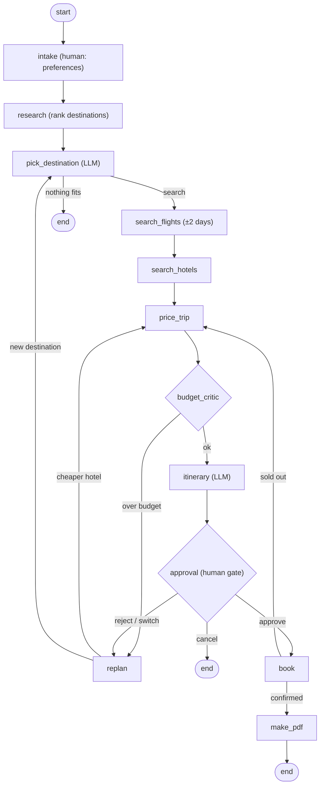

# AI Travel Planner

An agentic travel planner built with **LangGraph** and **LangChain**. Give it a budget, a month, a departure city and your interests. It researches destinations in India and abroad, picks one, searches flights and hotels, checks the budget, builds an itinerary, asks for your approval, books, and writes a PDF trip plan.

It uses free services only (free HuggingFace models, Duffel test mode, SerpAPI free tier, Open-Meteo), and every external service has an offline mock, so it runs with no API keys.

## Features

- **Destination research.** Ranks 31 destinations on interests, season (live weather from Open-Meteo), estimated cost and travel time.
- **Flexible-date flight search.** Searches ±2 days around your date and shifts only if it saves at least 8%.
- **Budget critic and re-planning.** Rejects plans over budget, then tries a cheaper hotel or a different destination.
- **Human in the loop.** One approval gate before any booking. You can approve, cancel, reject with free-text feedback, or pick another destination from the shortlist.
- **Failure recovery.** If a flight is sold out at booking time, the agent takes the next offer and re-checks the budget.
- **Reliable with small models.** Every LLM output is validated, with rule-based fallbacks, so a bad model reply never crashes the agent or triggers a booking.
- **Outputs.** A React web UI with the agent's reasoning streamed live, a terminal CLI, and a PDF itinerary.

## Architecture



Control flow (budget limits, the approval gate, retries) is fixed in the LangGraph graph, so it is guaranteed. Judgement calls (which destination, the itinerary text, what feedback means) go to the LLM.

## Tech stack

| Layer | Technology |
|---|---|
| Agent orchestration | LangGraph (`StateGraph`, conditional edges, `interrupt`, checkpointer) |
| Tools and LLM | LangChain (`@tool`, `ChatHuggingFace`) |
| LLM | HuggingFace model, run locally (default `Qwen2.5-1.5B-Instruct`) or via the HF Inference API |
| Flights | Duffel (test mode), SerpAPI Google Flights, or mock |
| Hotels | SerpAPI Google Hotels, or mock. Hotel booking is always simulated |
| Weather | Open-Meteo historical archive (no key) |
| Backend | FastAPI, streaming NDJSON |
| Frontend | React 18 and Vite |
| PDF | fpdf2 |

## Getting started

Requires Python 3.10+. Node.js is only needed if you edit the UI.

```bash
git clone https://github.com/Souvik-Vikie/AI-travel-planner.git
cd AI-travel-planner
python3 -m venv .venv && source .venv/bin/activate
pip install -r requirements.txt
cp .env.example .env        # optional: the app works without any keys
uvicorn travel_agent.api:app --port 8000
```

Open <http://localhost:8000>. The built UI is included in `frontend/dist`.

To run a model locally (free, no token), also run `pip install transformers torch` and set `LLM_BACKEND=hf_local` in `.env`.

### Configuration

All settings are in `.env` (see `.env.example`). Every key is optional:

| Variable | Purpose |
|---|---|
| `LLM_BACKEND` | `auto`, `hf_endpoint`, `hf_local`, or `none` (rule-based) |
| `HUGGINGFACEHUB_API_TOKEN` | HuggingFace Inference API token. Hosted inference needs available credit |
| `HF_LOCAL_MODEL_ID` | Local model, e.g. `Qwen/Qwen2.5-1.5B-Instruct` |
| `DUFFEL_API_TOKEN` | Duffel **test-mode** token (`duffel_test_...`) for flight search and sandbox booking |
| `SERPAPI_API_KEY` | SerpAPI key (free plan: 100 searches a month) for real flight and hotel prices |
| `FLEX_DAYS`, `MAX_REPLANS` | Date flexibility and re-plan limit |

Without keys the app uses mock prices and rule-based reasoning. The top bar of the UI shows which providers are active. To save free-tier quota, real providers search 3 dates instead of 5, and responses are cached.

> Never commit `.env`. It is gitignored.

### Terminal version

```bash
python main.py          # asks questions in the terminal
python main.py --demo   # pre-filled request
```

### Developing the UI

```bash
cd frontend
npm install
npm run dev      # http://localhost:5173, proxies /api to :8000
npm run build    # updates frontend/dist, which FastAPI serves
```

## Testing and evaluation

```bash
pytest -q                                 # 14 tests, always offline
python -m eval.run_eval                   # 20 varied trip requests
python -m eval.run_eval --reject-first    # a simulated human rejects every first plan
python -m eval.run_eval --use-llm         # with the LLM in the loop
```

Both commands force mock providers, so they never use API quota.

Results on 20 requests (7 origin cities, budgets ₹30k to ₹250k, 1 to 4 travellers, all months, rule-based, mock prices):

| Metric | Auto-approve | Human rejects first plan |
|---|---|---|
| Plans completed | 80% | 80% |
| Completed plans within budget | 94% | 88% |
| Re-planning triggered | 40% | 100% |
| Flexible dates used | 81% | 69% |
| Flight savings vs first-found offer | 33.9% | 30.8% |
| Flight and hotel savings vs first-found | 29.6% | 35.6% |

The 20% of requests that aren't completed are deliberately impossible budgets. The agent stops without booking and reports the cheapest plan it found. "First-found" means the first flight and hotel the provider returned, which is what a naive script would book. Savings come from mock prices, so re-run with real keys to measure real ones.

## Project structure

```
├── main.py                  # terminal CLI
├── travel_agent/
│   ├── graph.py             # LangGraph wiring
│   ├── nodes.py             # research, critic, re-plan, approval, booking
│   ├── state.py             # graph state
│   ├── api.py               # FastAPI backend
│   ├── runner.py            # stream, interrupt, resume loop
│   ├── llm.py               # HuggingFace via LangChain, validated JSON, fallbacks
│   ├── pdf_report.py        # PDF itinerary
│   ├── data.py              # destination catalogue and origin cities
│   └── tools/               # LangChain tools: destinations, weather, flights, hotels, booking
├── frontend/                # React + Vite UI
├── eval/run_eval.py         # benchmark
└── tests/                   # agent and API tests
```

## Limitations

- Hotel booking is simulated, and Duffel orders are sandbox orders, so no real money moves.
- Duffel test mode returns sandbox flights from a fake airline, not real prices. Use SerpAPI for real flight prices.
- The destination catalogue is curated (31 places), and fares are converted to INR with static rates.
- Small local models can invent facts in itinerary text. Costs and bookings come from code, not the model.
- Trips are held in memory, so restarting the server loses any trip in progress.

## Roadmap

- Persistent checkpointer (SQLite)
- Train and bus options for domestic trips
- LangSmith tracing
- Multi-city itineraries
